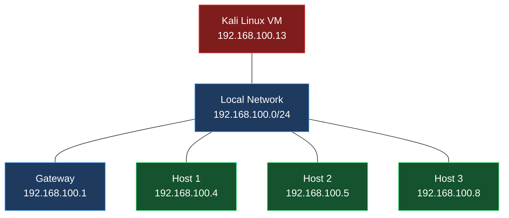

<div align="center">

# 🔐 MITM Attack Simulation
### ARP Spoofing & Network Traffic Analysis

**A practical cybersecurity lab using Kali Linux, Bettercap and Ettercap**


---

**Network Discovery • ARP Spoofing • MITM Analysis • Traffic Monitoring**

</div>

## 📖 Project Overview

This project explores the principles of **Man-in-the-Middle (MITM) attacks** using **ARP Spoofing** in a controlled network environment.

The simulation was conducted using **Kali Linux**, **Bettercap**, and **Ettercap**, running inside an **Oracle VirtualBox** virtual machine.

The main purpose is to understand how ARP vulnerabilities can affect network communications, analyze observable traffic, and investigate security mechanisms designed to prevent these attacks.

> [!IMPORTANT]
> This project was developed for educational and cybersecurity research purposes within an authorized network environment.

---

## 🎯 Project Objectives

- Understand the ARP protocol and its vulnerabilities.
- Explore the principles of Man-in-the-Middle attacks.
- Discover active devices within a local network.
- Identify IP and MAC address associations.
- Investigate ARP Spoofing using Bettercap.
- Analyze network traffic and packet activity.
- Explore Ettercap's network analysis capabilities.
- Study defensive mechanisms against ARP poisoning.

---

## 🛠️ Technologies & Tools

| Technology | Purpose |
|:---|:---|
| 🐉 **Kali Linux** | Penetration testing environment |
| 🔍 **Bettercap** | Network discovery, ARP spoofing research and packet analysis |
| 🕵️ **Ettercap** | Host discovery and network traffic analysis |
| 💻 **Oracle VirtualBox** | Virtual machine infrastructure |
| 🌐 **ARP** | IPv4-to-MAC address resolution |
| 🔗 **TCP/IP** | Network communication protocols |
| 📡 **mDNS** | Local network name resolution and discovery |

---

## 🖥️ Lab Environment

The experiment was performed on a local IPv4 network.

| Component | IP Address |
|:---|:---|
| 🐉 Kali Linux | `192.168.100.13` |
| 🌐 Default Gateway | `192.168.100.1` |
| 🔗 Local Network | `192.168.100.0/24` |
| 💻 Discovered Host 1 | `192.168.100.4` |
| 💻 Discovered Host 2 | `192.168.100.5` |
| 💻 Discovered Host 3 | `192.168.100.8` |

### Network Architecture



---

## 🧠 Understanding MITM & ARP Spoofing

### What is a Man-in-the-Middle Attack?

A **Man-in-the-Middle (MITM)** attack occurs when an unauthorized intermediary positions itself between two communicating devices.

Depending on the network configuration and security protections, the intermediary may attempt to observe, redirect, or manipulate traffic.

### What is ARP Spoofing?

**ARP Spoofing**, also called **ARP Poisoning**, exploits the trust-based behavior of the Address Resolution Protocol.

By introducing misleading IP-to-MAC associations, an attacker may cause devices to forward network traffic toward an unintended destination.

### Normal Communication


### MITM Attack Concept


> [!NOTE]
> The diagram illustrates the theoretical MITM traffic path. It does not establish that a complete MITM interception occurred during this experiment.

---

## 🔬 Experiment Workflow

### Phase 01 — Environment Setup

**Objective:** Prepare the virtualized penetration testing environment.

- Configure Kali Linux inside Oracle VirtualBox.
- Verify the virtual network adapter.
- Identify the Kali Linux IP address.
- Verify connectivity with the default gateway.

**Tools:** `Kali Linux` `VirtualBox`

### Phase 02 — Network Reconnaissance

**Objective:** Identify devices connected to the local network.

- Explore Bettercap's network discovery capabilities.
- Discover active hosts.
- Observe IP and MAC address associations.
- Review discovered hosts through Ettercap.

**Tools:** `Bettercap` `Ettercap`

### Phase 03 — ARP Spoofing Analysis

**Objective:** Study the ARP Spoofing mechanism.

- Explore Bettercap's `arp.spoof` module.
- Examine its configuration options.
- Investigate full-duplex spoofing behavior.
- Review ARP-related security warnings.

**Tool:** `Bettercap`

### Phase 04 — MITM Simulation

**Objective:** Observe the behavior of the ARP Spoofing module in the authorized lab.

The Bettercap module was started during the experiment.

The console displayed an ARP-related warning indicating that network protections could affect spoofing behavior.

**Observation:** Module startup was observed, but successful traffic redirection was not conclusively verified.

### Phase 05 — Traffic Monitoring

**Objective:** Inspect network packets visible to Kali Linux.

Bettercap's `net.sniff` functionality was explored to observe network activity.

The captured output included **mDNS traffic**, which is commonly used for local network discovery and name resolution.

> [!WARNING]
> Observing mDNS packets alone does not prove that traffic from another host was successfully intercepted.

### Phase 06 — Ettercap Analysis

**Objective:** Explore graphical network analysis capabilities.

- Launch the Ettercap graphical interface.
- Discover hosts on the local network.
- Inspect available host information.
- Compare reconnaissance observations with Bettercap.

---

## 📸 Experiment Screenshots

The following structure can be used to document the experiment.

<details>
<summary><b>📷 Screenshot 01 — Kali Linux Environment</b></summary>

<br>

Add a screenshot showing the Kali Linux virtual machine and its network configuration.

`./screenshots/01-kali-environment.png`

</details>

<details>
<summary><b>📷 Screenshot 02 — Network Discovery</b></summary>

<br>

Add a screenshot showing the hosts discovered using Bettercap.

`./screenshots/02-network-discovery.png`

</details>

<details>
<summary><b>📷 Screenshot 03 — ARP Spoofing Module</b></summary>

<br>

Add a screenshot showing the Bettercap ARP Spoofing module and its output.

`./screenshots/03-arp-spoofing.png`

</details>

<details>
<summary><b>📷 Screenshot 04 — Network Traffic Analysis</b></summary>

<br>

Add a screenshot showing the observed network packets, including mDNS traffic.

`./screenshots/04-traffic-analysis.png`

</details>

<details>
<summary><b>📷 Screenshot 05 — Ettercap Host Discovery</b></summary>

<br>

Add a screenshot showing the Ettercap host discovery interface.

`./screenshots/05-ettercap.png`

</details>

---

## 📊 Results & Observations

| Test | Observation | Status |
|:---|:---|:---:|
| Kali Linux environment | Virtual machine configured | ✅ |
| Network discovery | Multiple hosts identified | ✅ |
| IP/MAC identification | Address associations observed | ✅ |
| Bettercap ARP module | Module started | ✅ |
| ARP protection warning | Warning observed | ⚠️ |
| Traffic monitoring | mDNS packets detected | ✅ |
| Ettercap reconnaissance | Host list explored | ✅ |
| Complete MITM interception | Not conclusively verified | ⚠️ |

### Key Findings

**1. Network visibility**

Bettercap and Ettercap provided useful capabilities for discovering devices and inspecting local network information.

**2. ARP security considerations**

The experiment highlighted the importance of ARP-related security protections.

**3. Traffic analysis**

Network monitoring revealed observable mDNS activity.

**4. Verification limitations**

The available evidence was insufficient to establish a successful end-to-end MITM interception.

---

## 🛡️ Security Recommendations

Several mechanisms can reduce the risks associated with ARP Spoofing.

| Security Mechanism | Protection |
|:---|:---|
| **Dynamic ARP Inspection** | Validates ARP packets on supported switches |
| **DHCP Snooping** | Helps establish trusted IP/MAC binding information |
| **ARP Monitoring** | Detects suspicious changes in address associations |
| **HTTPS / TLS** | Protects application data in transit |
| **Network Segmentation** | Limits unnecessary communication between devices |
| **Router / Switch Protections** | Helps prevent unauthorized ARP manipulation |

> [!TIP]
> Defense in depth is recommended. Network-layer protections and encrypted application protocols address different security risks.

---

## 📚 Skills Developed

Through this practical cybersecurity experiment, the following technical concepts were explored:

- **Network Security:** MITM attack concepts and defensive mechanisms.
- **Networking:** ARP, TCP/IP, IP addressing and MAC addressing.
- **Linux Administration:** Working with Kali Linux.
- **Virtualization:** Configuring virtual environments using VirtualBox.
- **Network Reconnaissance:** Discovering hosts and examining local networks.
- **Traffic Analysis:** Observing network activity with Bettercap.
- **Security Research:** Understanding ARP poisoning risks and limitations.

---

## 📁 Repository Structure

```text
MITM-ARP-Spoofing-Lab/
│
├── README.md
│
└── screenshots/
    ├── 01-kali-environment.png
    ├── 02-network-discovery.png
    ├── 03-arp-spoofing.png
    ├── 04-traffic-analysis.png
    └── 05-ettercap.png
```

*The screenshot filenames are suggested placeholders and should be adapted to the actual repository contents.*

---

## ⚖️ Ethical & Legal Disclaimer

This repository documents an educational network security experiment conducted in a controlled and authorized environment.

All testing must be performed exclusively on systems and networks owned by the tester or for which explicit authorization has been granted.

The purpose of this project is to promote cybersecurity education, responsible experimentation, and defensive security awareness.

---

## 🏁 Conclusion

This project provided practical exposure to **Man-in-the-Middle attack concepts**, **ARP Spoofing**, and **network traffic analysis** using Kali Linux, Bettercap, and Ettercap.

The experiment demonstrated network reconnaissance capabilities, ARP Spoofing module behavior, and observable local network traffic.

It also highlighted the importance of properly verifying experimental results and implementing appropriate network security controls.

---

<div align="center">

### 🔐 Network Security Laboratory

**Kali Linux • Bettercap • Ettercap • VirtualBox**

*Cybersecurity | Ethical Hacking | Network Analysis*

</div>
